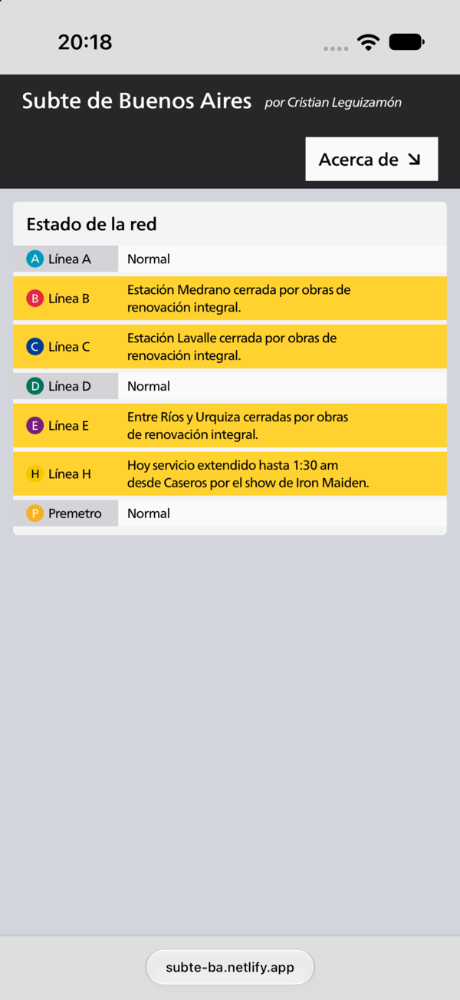

**Español** · [English](README.en.md)

<table>
  <tr>
    <td width="38%" align="center" valign="middle">
      
      <br />
      <sub>Estado de la red en mobile</sub>
    </td>
    <td width="62%" valign="middle">
      <h1>Subte de Buenos Aires</h1>
      <p>Horarios estimados en tiempo real para las líneas A, B, C, D, E, H y el Premetro. Pensado para el celular, para consultar en la calle.</p>
      <p><a href="https://subte-ba.netlify.app"><strong>Ver sitio en vivo ↗</strong></a></p>
      <ul>
        <li>Llegadas por estación y sentido</li>
        <li>Alertas y estado de la red</li>
        <li>Sin app ni registro</li>
      </ul>
      <p><sub>Astro 7 SSR · Preact · Tailwind CSS 4 · Netlify</sub></p>
    </td>
  </tr>
</table>

## Cómo funciona

En la primera petición, el servidor descarga el GTFS estático de la API de Transporte del GCBA y luego lo refresca cada 30 minutos. Las posiciones del feed `forecastGTFS` se cachean 30 segundos. El navegador consulta `GET /api/forecast/{routeId}` cada 30 segundos y calcula los arribos del lado del cliente.

```text
API GCBA ──► caché del servidor ──► /api/forecast/{routeId} ──► islas Preact
```

- **GTFS estático**: rutas y estaciones para armar cada línea.
- **forecastGTFS**: posiciones y próximos arribos de los trenes.
- **serviceAlerts**: estado de la red y avisos por línea.

## Ficha técnica

| Área | Detalle |
| --- | --- |
| Runtime | Astro 7 en modo SSR (`output: "server"`) |
| UI | Preact (islas) y componentes Astro |
| Estilos | Tailwind CSS 4 |
| Datos | API Transporte GCBA (GTFS, forecastGTFS, serviceAlerts) |
| Caché | GTFS: 30 min · posiciones: 30 s |
| Deploy | Netlify |
| Node | ≥ 22.12 |

## Empezar

Requisitos: Node ≥ 22.12 y credenciales de la [API de Transporte del GCBA](https://buenosaires.gob.ar/gcaba_historico/infraestructura/movilidad/api-transporte).

```bash
npm install
```

Creá un archivo `.env` en la raíz con las credenciales:

```env
GCBA_CLIENT_ID=tu_client_id
GCBA_CLIENT_SECRET=tu_client_secret
```

```bash
npm run dev
```

El sitio queda disponible en `http://localhost:4321`.

## Scripts

| Comando | Qué hace |
| --- | --- |
| `npm run dev` | Servidor de desarrollo en `localhost:4321` |
| `npm run build` | Build de producción en `dist/` |
| `npm run astro ...` | CLI de Astro (`astro add`, `astro check`, etc.) |

## Estructura

```text
.
├── docs/screenshots/   # capturas para el README
├── public/             # assets estáticos
├── src/
│   ├── api/            # acceso a datos (alertas)
│   ├── components/     # islas Preact y componentes Astro
│   ├── layouts/
│   ├── pages/          # rutas del sitio y endpoint /api/forecast
│   ├── services/       # descarga, caché y parseo de GTFS
│   ├── styles/
│   └── utils/          # cálculo de tiempos de arribo
├── astro.config.mjs
├── netlify.toml
└── package.json
```

## Datos y atribución

Datos abiertos del Gobierno de la Ciudad de Buenos Aires a través de la [API de Transporte](https://buenosaires.gob.ar/gcaba_historico/infraestructura/movilidad/api-transporte).

Proyecto personal de [Cristian Leguizamón](https://github.com/pudinero).
